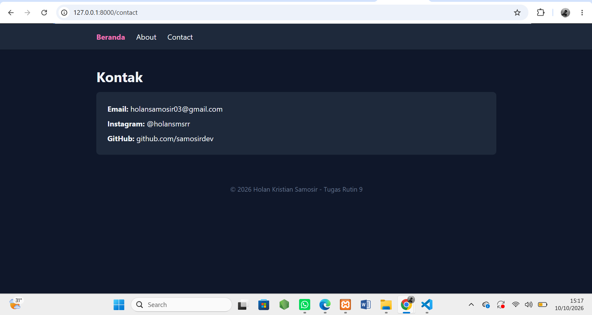
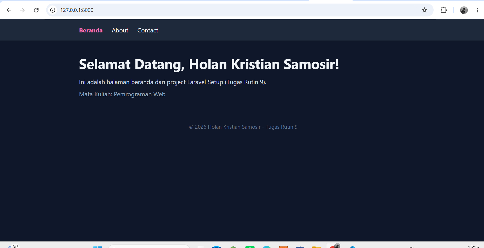
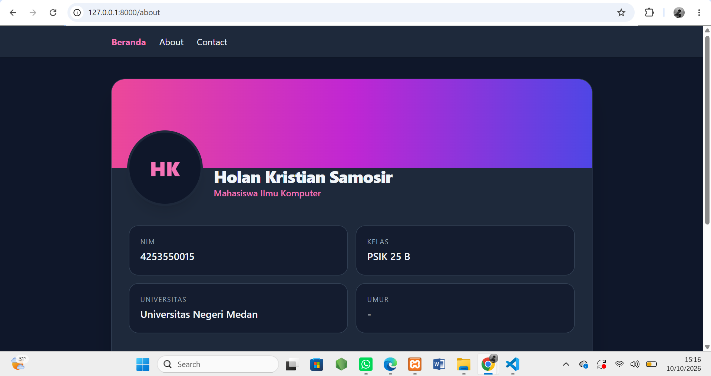

# TugasWeb-P9-LaravelSetup

## Prasyarat
- PHP >= 8.2
- Composer
- MySQL / XAMPP
- Git

## Langkah Instalasi
1. Clone repository
```bash
   git clone https://github.com/samosirdev/TugasWeb-Pertemuan9-Laravel-Setup.git
   cd TugasWeb-P9-LaravelSetup
```
2. Install dependency
```bash
   composer install
```
3. Salin file environment
```bash
   copy .env.example .env
```
4. Generate application key
```bash
   php artisan key:generate
```
5. Buat database `tugasweb_p9` di phpMyAdmin, lalu atur `.env`:
```env
   DB_CONNECTION=mysql
   DB_HOST=127.0.0.1
   DB_PORT=3306
   DB_DATABASE=tugasweb_p9
   DB_USERNAME=root
   DB_PASSWORD=
```
6. Jalankan migrasi
```bash
   php artisan migrate
```
7. Jalankan server
```bash
   php artisan serve
```
8. Buka http://127.0.0.1:8000

## Daftar Route
| URL | Keterangan |
|---|---|
| `/` | Beranda |
| `/about` | Profil |
| `/contact` | Kontak |
| `/mahasiswa` | Data dari controller |
| `/hello/{nama}` | Bonus route parameter |

## Struktur Folder

```
TugasWeb-P9-LaravelSetup/
├── app/
│   ├── Http/Controllers/
│   │   ├── Controller.php
│   │   └── MahasiswaController.php
│   ├── Models/
│   │   ├── Mahasiswa.php
│   │   └── User.php
│   └── Providers/
├── bootstrap/
├── config/
├── database/
│   ├── factories/
│   ├── migrations/
│   └── seeders/
├── public/
├── resources/
│   ├── css/
│   ├── js/
│   └── views/
│       ├── layouts/app.blade.php
│       ├── home.blade.php
│       ├── about.blade.php
│       ├── contact.blade.php
│       └── mahasiswa.blade.php
├── routes/
│   ├── web.php
│   └── console.php
├── storage/
├── tests/
├── vendor/
├── .env
├── artisan
└── composer.json
```

## Penjelasan Struktur Folder
| Folder / File | Fungsi |
|---|---|
| `app/Http/Controllers/` | Menyimpan controller (logika request) |
| `app/Models/` | Model Eloquent (representasi tabel database) |
| `bootstrap/` | File bootstrap framework & cache |
| `config/` | File konfigurasi aplikasi |
| `database/migrations/` | Skema/struktur tabel database |
| `database/seeders/` | Data awal untuk database |
| `public/` | Entry point (`index.php`) & aset publik |
| `resources/views/` | Template Blade (tampilan) |
| `routes/web.php` | Definisi route web |
| `storage/` | Log, cache, dan file upload |
| `tests/` | File pengujian |
| `vendor/` | Dependency dari Composer (jangan di-commit) |
| `.env` | Konfigurasi environment (jangan di-commit) |
| `artisan` | CLI Laravel |
| `composer.json` | Daftar dependency PHP |

## Screenshot




TugasWeb-Pertemuan9-LaravelSetup